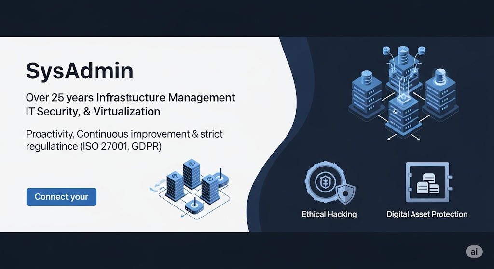
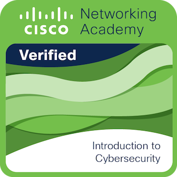
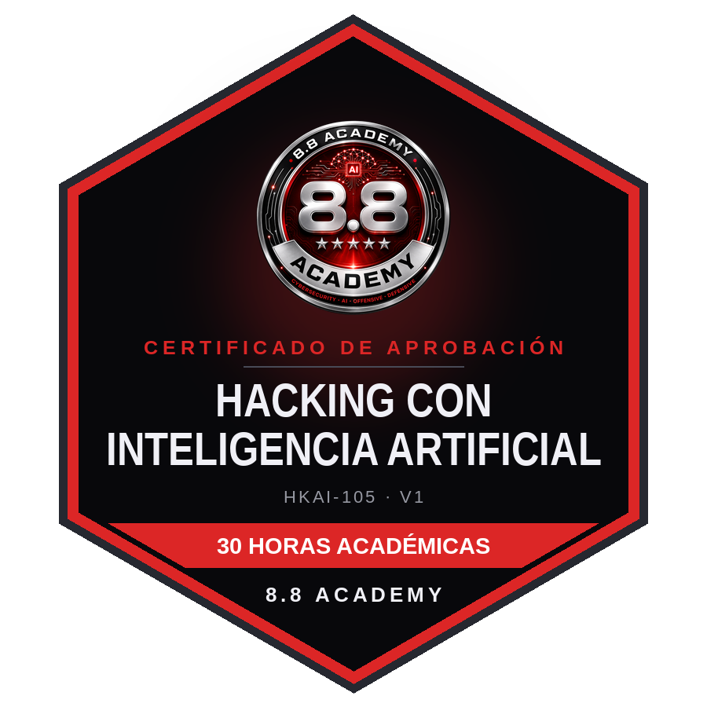
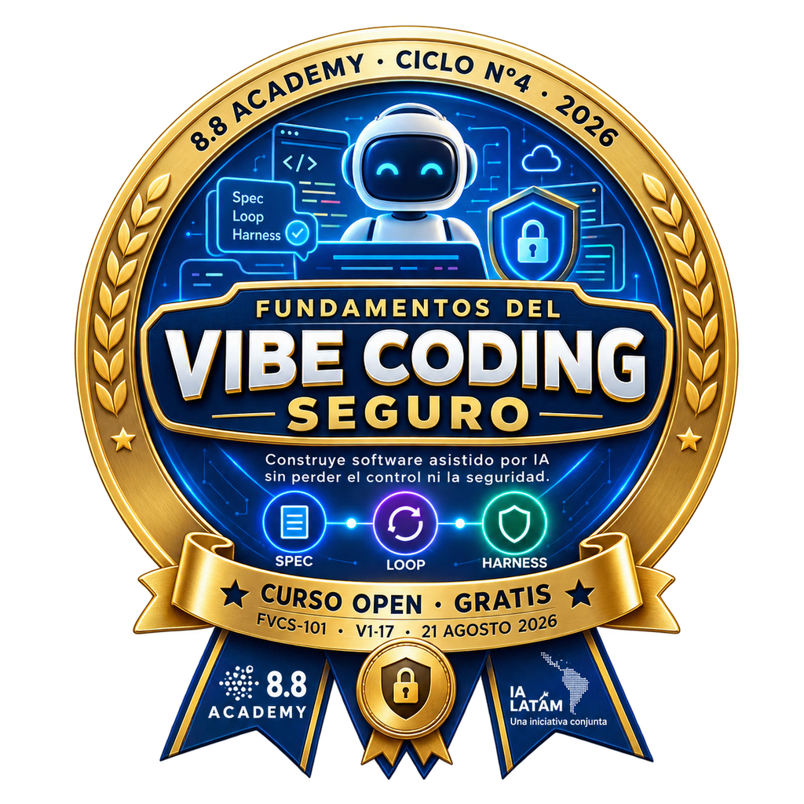
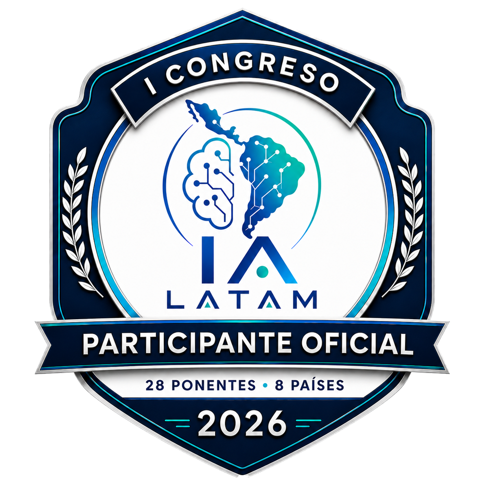
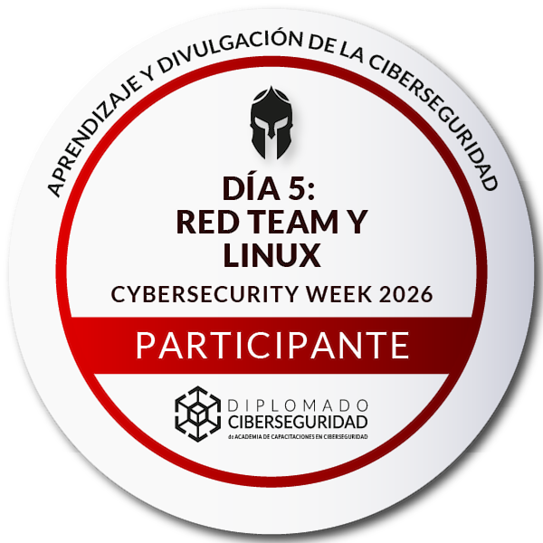
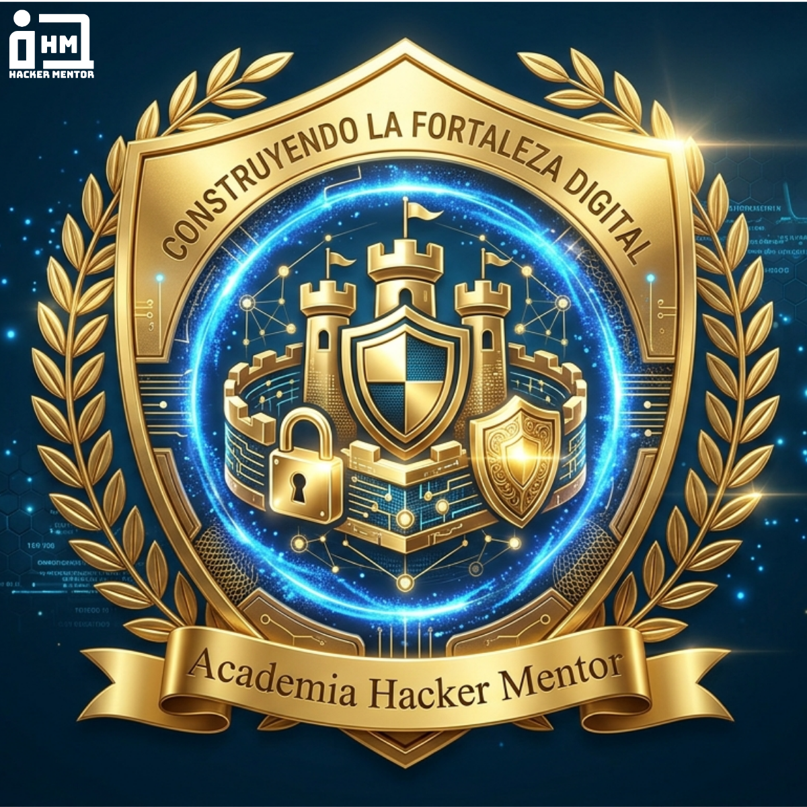
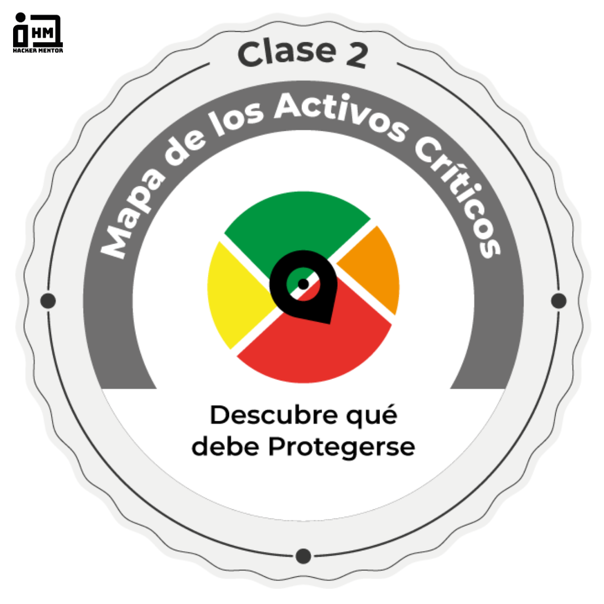
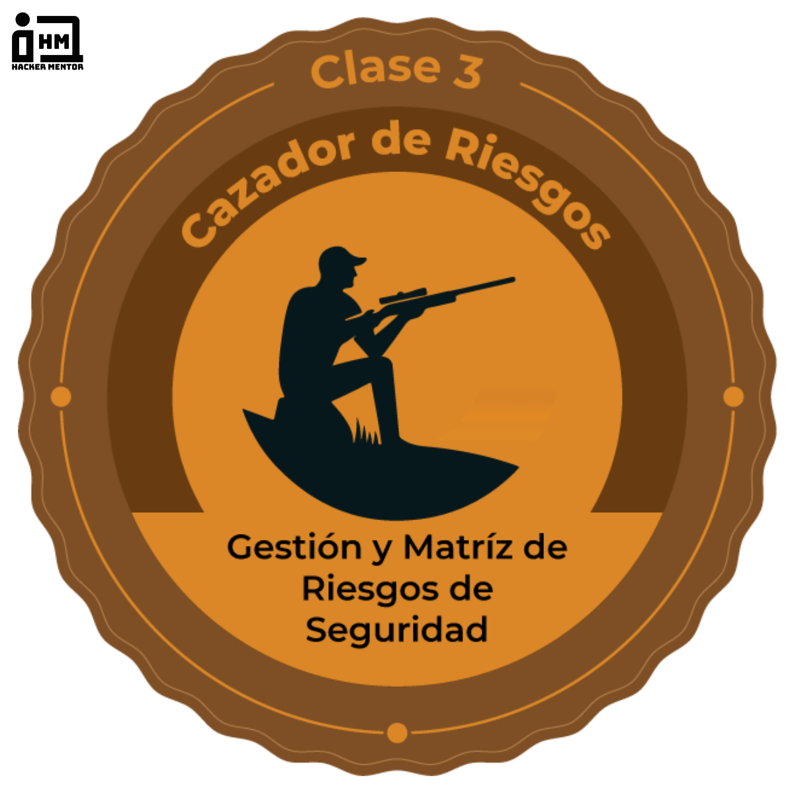

# Juan Carlos Araneda Morales

### **Especialista en Ciberseguridad | SysOps | SysAdmin | Administrador de Infraestructura TI & Redes**

---

## 📌 Tabla de Contenidos

- [Perfil Profesional](#-perfil-profesional)
- [Habilidades y Competencias Técnicas](#-habilidades-y-competencias-técnicas)
- [Experiencia Laboral](#-experiencia-laboral)
- [Formación Académica](#-formación-académica)
- [Certificaciones y Especializaciones Técnicas](#-certificaciones-y-especializaciones-técnicas)
- [Insignias y Credenciales Digitales](#️-insignias-y-credenciales-digitales)
- [Índice de Documentos del Repositorio](#-índice-de-documentos-del-repositorio)
- [Logros y Proyectos Destacados](#-logros-y-proyectos-destacados)

---

## 👨‍💻 Perfil Profesional

Profesional de las Tecnologías de la Información con **más de 20 años de trayectoria** liderando operaciones críticas de infraestructura TI, administración de redes corporativas, soporte técnico avanzado y ciberseguridad ofensiva/defensiva en entornos empresariales.

Especializado en la implementación y securitización de infraestructuras híbridas (On-Premise y Cloud), administración de sistemas **Linux** (RHEL, Ubuntu, Debian) y **Windows Server**, virtualización (**VMware**, **Proxmox**, **Docker**, **Hyper-V**), soluciones de almacenamiento NAS y redes de alto rendimiento (**Cisco**, **Fortinet**, **Ubiquiti**).

En el área de **Ciberseguridad**, cuenta con experiencia probada en evaluaciones de seguridad ofensiva (Pentesting Web, Red Team), análisis y gestión de vulnerabilidades (Nessus, Qualys, Burp Suite, Kali Linux), auditorías de cumplimiento bajo **CIS Benchmark**, **PCI DSS** y **OWASP**, hardening de sistemas, auditoría de identidades (IAM, RBAC, MFA) y securitización de entornos **Microsoft 365**, **Google Workspace** y **GCP**.

---

## 🛠 Habilidades y Competencias Técnicas

### 🔐 Ciberseguridad & Seguridad de la Información
- **Seguridad Ofensiva & Defensiva:** Web Application Pentesting, Red Team, Blue Team (ciberinteligencia, forense y respuesta a incidentes), Ethical Hacking.
- **Análisis de Vulnerabilidades & SAST/DAST:** Nessus, Qualys, Burp Suite, Kali Linux, Prisma Cloud (SAST), OWASP Top 10, CWE, CVSS 4.0.
- **Normativas & Cumplimiento:** CIS Benchmark, PCI DSS, controles de acceso, gestión de riesgos, Least Privilege, MFA, RBAC.
- **Securitización de Plataformas Cloud & Endpoint:** Microsoft Defender (Endpoint, Office, XDR), Microsoft Intune (MDM, MAM, Conditional Access, Autopilot), Google Workspace Security, GCP.

### 🌐 Redes e Infraestructura de Comunicaciones
- **Equipamiento de Red:** Firewalls Fortinet (FortiGate), Switches y Routers Cisco, equipamiento Ubiquiti Networks (UniFi).
- **Protocolos y Servicios:** TCP/IP, VLAN, QoS, VPN (IPSec, SSL-VPN), DNS, DHCP, NAT, enrutamiento estático y dinámico.
- **Seguridad Perimetral:** Reglas de firewalling, filtrado de contenido, inspección SSL, políticas de acceso remoto seguro.

### 🖥️ Sistemas Operativos, Servidores & Virtualización
- **Sistemas Operativos:** Linux (Red Hat Enterprise Linux, Ubuntu Server, Debian), Windows Server (2012, 2016, 2019, 2022).
- **Servicios de Directorio:** Active Directory Domain Services (AD DS), migración local a On-Premise / Híbrido, Group Policy Objects (GPOs).
- **Virtualización & Contenedores:** VMware ESXi / vSphere, Proxmox VE, Hyper-V, KVM, Docker.
- **Cloud & Almacenamiento:** Amazon Web Services (AWS - EC2, S3, Route 53), Google Cloud Platform (GCP), NAS Synology (RAID, replicación y respaldos automatizados).

### ⚙️ Automatización, Monitoreo & Herramientas
- **Automatización & Scripting:** Bash, PowerShell, Python, Ansible.
- **Monitoreo & Observabilidad:** Nagios, análisis de tráfico de red, consolas centralizadas (ESET Protect Cloud).
- **Soporte & Gestión:** Mesa de ayuda L1/L2/L3, resolución de problemas críticos, gestión de SLAs, gestión de compras de equipamiento y piezas computacionales.

---

## 💼 Experiencia Laboral

### **Especialista en Ciberseguridad** | *NIVEL4 CyberSecurity*
**Octubre 2025 – Julio 2026**
- Ejecución de evaluaciones de seguridad ofensiva: pruebas de penetración web (*Web Application Pentesting*), ejercicios de Red Team y análisis de vulnerabilidades en infraestructura tecnológica.
- Realización de auditorías de ciberseguridad basadas en estándares **CIS Benchmark** y **PCI DSS**, evaluando el cumplimiento en entornos Windows y Linux.
- Implementación de procesos de *hardening* en servidores y sistemas operativos corporativos para elevar la postura de seguridad de los clientes.
- Evaluación de seguridad en clientes de los sectores financiero, salud y retail.
- Uso avanzado de herramientas de auditoría y análisis: Kali Linux, Burp Suite, Nessus y Qualys, generando informes ejecutivos y técnicos con planes de remediación.
- Fortalecimiento de políticas y controles en Microsoft Intune (Device Compliance, Conditional Access, Autopilot, MDM/MAM) y Microsoft Defender (Endpoint, Office y XDR).
- Auditoría de controles de Identity and Access Management (IAM), Least Privilege, autenticación multifactor (MFA) y Access Reviews en Microsoft 365 y Google Workspace.
- Liderazgo en revisiones de seguridad SAST (Prisma Cloud) y validaciones web (OWASP v4, CWE, CVSS 4.0) en aplicaciones estratégicas; evaluación técnica de plataformas de aplicación (WildFly, Tomcat) para migración segura de aplicaciones Java.

### **SysOps / SysAdmin / Encargado de Soporte, Web y Redes** | *Club Hípico de Santiago S.A.*
**Noviembre 2011 – Octubre 2025**
- Administración integral y mantenimiento de la infraestructura tecnológica, garantizando alta disponibilidad, confidencialidad e integridad de las operaciones.
- Soporte técnico de primer y segundo nivel (L1/L2) para más de cientos de usuarios y estaciones de trabajo, resolviendo incidencias críticas de hardware, software y conectividad.
- Administración y mantenimiento de servidores Linux (RHEL, Ubuntu) y Windows Server, ejecutando tareas de parcheo, mantenimiento preventivo y *hardening*.
- Implementación de plataformas de virtualización con VMware, Proxmox VE y Docker, optimizando el aprovechamiento del hardware en más de un 40%.
- Gestión de almacenamiento centralizado NAS Synology, implementando estrategias de backup automatizado, tolerancia a fallos y planes de recuperación ante desastres (DRP).
- Configuración y securitización de redes: Firewalls Fortigate, switches Cisco y enlaces Ubiquiti, desplegando VLANs segmentadas, QoS, VPN corporativas y políticas de seguridad perimetral.
- Gestión de servicios web corporativos y plataforma AWS (administración de DNS, dominios y servidores web).
- Migración y administración de Active Directory.
- **Logro destacado:** Implementación del sistema de teletrabajo seguro en tiempo récord ante la emergencia sanitaria COVID-19, asegurando la continuidad total de las operaciones corporativas con tecnologías Fortinet, Cisco y Ubiquiti.

### **Encargado de Soporte y Administrador de Redes** | *Seguros Generales Liberty S.A.*
**Noviembre 2010 – Septiembre 2011**
- Administración y mantenimiento de servidores Windows Server y Linux (RHEL/Ubuntu), plataformas web e infraestructura de redes corporativas.
- Administración de virtualización (VMware, Proxmox, Docker) y almacenamiento NAS para respaldos y continuidad.
- Soporte técnico Nivel 1 y 2, resolviendo incidentes de conectividad y plataformas corporativas.
- Implementación de medidas de ciberseguridad, hardening y control de acceso.
- **Logro clave:** Reducción del 30% en los tiempos de respuesta a incidentes mediante la optimización de procesos y documentación técnica.

### **Administrador de Red y Encargado de Soporte TI** | *Red Metalpar S.A.*
**Abril 2008 – Febrero 2009**
- Administración de Active Directory (gestión de usuarios, grupos, políticas de grupo GPO y permisos).
- Configuración y gestión de firewall Fortinet FortiGate: reglas de seguridad, VPN para accesos remotos y filtrado de navegación.
- Soporte técnico presencial y remoto a usuarios; gestión de inventario y compras de piezas y partes computacionales.
- **Logro clave:** Reducción del 25% en fallos de conectividad mediante segmentación de redes y mantenimiento preventivo.

### **Encargado de Informática y Administrador de Red** | *Berlitz Escuelas de Idiomas*
**Abril 2007 – Enero 2008**
- Administración de servidores Windows y Linux, mantenimiento preventivo y correctivo de la plataforma TI.
- Configuración de firewalls y accesos seguros vía VPN para sedes y usuarios remotos.
- **Logro clave:** Incremento del 35% en la disponibilidad de los servicios tecnológicos mediante modernización de equipamiento.

### **Administrador de Redes (Outsourcing SYSTECH)** | *Clínica Fundación Médica San Cristóbal*
**Agosto 2006 – Marzo 2007**
- Liderazgo en el proyecto de estandarización, diseño y modernización de la red corporativa (switches, routers y firewall).
- Documentación técnica y capacitación al equipo interno para la operación de la nueva infraestructura.

### **Otras Experiencias Relevantes**
- **Claro Chile / Securynet** (2006 – 2007): Administrador de Red en Proyecto Triangulación de Antenas Móviles Claro.
- **Isapre Consalud** (2006): Soporte Técnico especializado para el Proyecto de Implementación de Active Directory corporativo.
- **Hotel Plaza San Francisco / Partner Consulting** (2005 – 2006): Administrador de Sistemas y Soporte.
- **SQL Technology / Natura Cosméticos** (2004 – 2005): Administrador de Red interna y soporte computacional.
- **Grupo ING** (2003 – 2004): Técnico en Terreno y Mesa de Ayuda (Help Desk y soporte de infraestructura).
- **PREGO Soluciones Tecnológicas / Seguros Cruz del Sur** (2002 – 2003): Help Desk y soporte técnico en hardware/software.

---

## 🎓 Formación Académica

| Carrera / Programa | Institución | Estado / Periodo | Documento de Respaldo |
| :--- | :--- | :--- | :---: |
| **Ingeniería en Ciberseguridad** | Instituto Profesional IACC | *Marzo 2025 – En curso* | [Certificado Alumno Regular (PDF)](Certificados/CERTIFICADO%20ALUMNO%20REGULAR.pdf) |
| **Ingeniería en Informática** | Instituto Profesional INACAP | *2019 – 2020* | — |
| **Ingeniería en Telemática** | Instituto CIISA | *2010 – 2011* | — |
| **Analista de Sistemas** | DUOC UC | *Carrera cursada* | — |

---

## 📜 Certificaciones y Especializaciones Técnicas

Todas las certificaciones listadas a continuación cuentan con verificación oficial (8.8 Academy / IA LATAM / HolaMundo / Google & Coursera / Cisco / BIG school / SENCE / IACC / Hacker Mentor / Diplomados en Ciberseguridad) y sus documentos respaldatorios se encuentran almacenados y accesibles dentro de este repositorio:

| Certificación / Curso | Institución Emisora | Horas / Fecha | Código / Hash de Verificación | Documento Verificado |
| :--- | :--- | :---: | :---: | :---: |
| **Obsidian: Tu Segundo Cerebro con IA** | HolaMundo (holamundo.io) | 25-09-2026 | `fkkmmwl5pn` | [Diploma (PDF)](Certificados/holamundo-diploma-obsidian-segundo-cerebro-con-ia.pdf) |
| **Hacking con Inteligencia Artificial (HKAI-105)** | 8.8 Academy | 30 hrs (08-08-2026) | [`OC-9F78B5CF`](https://openchapitas.org) | [Diploma (PDF)](Certificados/8dot8-diploma-hacking-con-ia.pdf) |
| **Fundamentos del Vibe Coding Seguro (FVCS-101)** | 8.8 Academy / IA LATAM | 7.5 hrs (25-08-2026) | [`OC-B63FAC93`](https://openchapitas.org) (Distinción de Excelencia - Nota 7.0) | [Diploma (PDF)](Certificados/8dot8-ialatam-diploma-vibe-coding-seguro.pdf) |
| **1er Congreso IA LATAM 2026** | Comunidad IA LATAM | 20 hrs (01-08-2026) | [`OC-265A54B5`](https://openchapitas.org) | [Diploma (PDF)](Certificados/ialatam-diploma-1er-congreso-2026.pdf) |
| **Connect and Protect: Networks and Network Security** | Google / Coursera | 11-05-2026 | [`QX76OD61KJUN`](https://coursera.org/verify/QX76OD61KJUN) | [Ver PDF](Certificados/Google-Cybersecurity-Connect-and-Protect.pdf) |
| **Sound the Alarm: Detection and Response** | Google / Coursera | 11-05-2026 | [`KW3AWNZLZBTL`](https://coursera.org/verify/KW3AWNZLZBTL) | [Ver PDF](Certificados/Google-Cybersecurity-Sound-the-Alarm-Detection-and-Response.pdf) |
| **Fundamentos de Hacking con Inteligencia Artificial** | 8dot8Academy | 21-04-2026 | `cert_t476m55b` | [Ver PDF](Certificados/certificate-of-completion-for-fundcia-fundamentos-de-hacking-con-inteligencia-artificial.pdf) |
| **Fundamentos DPO (RGPD y Ley Nº 21.719 de Chile)** | 8dot8Academy | 21-04-2026 | `cert_sryfjngb` | [Ver PDF](Certificados/certificate-of-completion-for-fundatos-del-rol-del-delegado-de-proteccion-de-datos-dpo.pdf) |
| **Ciberseguridad y Hacking Ético: Detección y Defensa** | BIG school | 6 hrs (10-04-2026) | Acreditado Romuald Fons / Mario Álvarez | [Ver PDF](Certificados/Certificado-Juan-Carlos-Araneda-Morales-gr0cs2on.pdf) |
| **Certificado Alumno Regular (Ciberseguridad)** | Instituto Profesional IACC | Vigente 2026 | `6582657869689958401` | [Ver PDF](Certificados/CERTIFICADO%20ALUMNO%20REGULAR.pdf) |
| **Técnicas de Ataque Ético (Ethical Hacking)** | Global Solution Consultores S.A. / SENCE | 16 hrs | `3E83099D-DCC8-4BAF-B7C5-E43A849E466F` | [Ver PDF](Certificados/T%C3%A9cnicas%20de%20Ataque%20Etico%20(Ethical%20Hacking).pdf) |
| **Introducción a la Ciberseguridad** | Cisco Networking Academy | 11-03-2025 | Credencial Oficial Verificada (QR) | [Diploma (PDF)](Certificados/Introduccion%20a%20la%20Ciberseguridad%20Cisco.pdf) • [Credencial & Insignia (PDF)](Certificados/Cisco%20Certificate%20of%20Course%20Completion%20(Credential%20&%20Badge).pdf) |
| **Fundamentos en Blue Team Ciberinteligencia, Forense y Resp.** | Diplomados en Ciberseguridad | 19-06-2026 | Acreditado Carlos Lobos de Medina | [Ver PDF](Certificados/Diplomado-Ciberseguridad-Fundamentos-Blue-Team.pdf) |
| **Fundamentos de Análisis de Redes v.1** | Diplomados en Ciberseguridad | 15 hrs (19-06-2026) | 15 Créditos Ed. Profesional | [Ver PDF](Certificados/Diplomado-Ciberseguridad-Fundamentos-Analisis-de-Redes.pdf) |
| **ISO/IEC 27001: Implementación & Gestión (Clases 1, 2 y 3)** | Hacker Mentor | 2026 | Insignias Digitales Verificadas | [Clase 1 (PDF)](Certificados/Hacker-Mentor-Insignia-1-Construyendo-la-Fortaleza-Digital.pdf) • [Clase 2 (PDF)](Certificados/Hacker-Mentor-Insignia-2-Mapa-de-los-Activos-Criticos.pdf) • [Clase 3 (PDF)](Certificados/Hacker-Mentor-Insignia-3-Cazador-de-Riesgos.pdf) |
| **Técnicas de Adm. y Securitización de Servidores Linux** | IT Wall S.A. / SENCE | 100 hrs | `D71F6C79-E28C-4C58-843D-805E001CC85D` | [Ver PDF](Certificados/T%C3%A9cnicas%20De%20Administraci%C3%B3n%20Y%20Securitizaci%C3%B3n%20De%20Servidores%20Linux..pdf) |
| **Administración de Servidores** | IT Wall S.A. / SENCE | 30 hrs | `5BB87423-B7D1-4D37-800F-88A8ECB7CC88` | [Ver PDF](Certificados/Administraci%C3%B3n%20De%20Servidores.pdf) |
| **Técnicas de Programación en Lenguaje Java** | IT Wall S.A. / SENCE | 100 hrs | `D4509820-8160-40DA-A504-A067F807ADAD` | [Ver PDF](Certificados/Tecnicas%20De%20Programacion%20En%20Lenguaje%20Java.pdf) |
| **Gestión de Comunicación y Resolución de Conflictos** | Capacitaciones Andres Rojas Farias / SENCE | 200 hrs | `CB0A97B5-3B19-4FB1-B9C7-104F3CD6F75F` | [Ver PDF](Certificados/Herramientas%20de%20gesti%C3%B3n%20de%20comunicaci%C3%B3n%20y%20resoluci%C3%B3n%20de%20conflictos.pdf) |
| **Manejo de Excel en el Mundo del Trabajo** | E-Syste Capacitación S.A. / SENCE | 60 hrs | `5A71E468-FBC2-498A-BDC0-584DEABBFAF8` | [Ver PDF](Certificados/Manejo%20de%20Excel%20En%20El%20Mundo%20Del%20Trabajo.pdf) |
| **Operación y Mantención de Equipos de TV Digital** | Sociedad de Adiestramiento Ocupacional / SENCE | 40 hrs | `49AF53CC-ABB2-44A1-8733-21771383D68D` | [Ver PDF](Certificados/Operaci%C3%B3n%20y%20Mantenci%C3%B3n%20de%20Equipos%20de%20Televisi%C3%B3n%20Digital.pdf) |
| **Evaluación de Desempeño y Empoderamiento** | Capacitación Capital Humano S.A. / SENCE | 12 hrs | `0FDC1493-B799-4264-BB80-A6ED2A8D7CC2` | [Ver PDF](Certificados/EVALUACI%C3%93N%20DE%20DESEMPE%C3%91O%20Y%20EMPODERAMIENTO.pdf) |
| **Técnicas para la Comunicación** | Comunicación y Desarrollo Integral / SENCE | 12 hrs | `78CE54EC-05B5-4B1F-9072-17D2DCA0F1AF` | [Ver PDF](Certificados/T%C3%A9cnicas%20Para%20La%20comunicaci%C3%B3n.pdf) |
| **Administración de Bodega** | Capacitación Capital Humano S.A. / SENCE | 16 hrs | `D78D7310-BA40-4D83-8191-10CB003FB4CD` | [Ver PDF](Certificados/Administraci%C3%B3n%20De%20Bodega.pdf) |
| **Técnicas de Venta** | Fundación de Capacitación Sofofa / SENCE | 12 hrs | `053A2F56-19F3-4051-B548-BC8162316450` | [Ver PDF](Certificados/T%C3%89CNICAS%20DE%20VENTA.pdf) |

### 🎖️ Insignias y Credenciales Digitales

<table>
  <tr>
    <td align="center" width="25%">
      <a href="Certificados/Cisco%20Certificate%20of%20Course%20Completion%20(Credential%20&%20Badge).pdf">
         
        <b>Cisco Networking Academy</b> 
        Introduction to Cybersecurity
      </a>
    </td>
    <td align="center" width="25%">
      <a href="Certificados/8dot8-diploma-hacking-con-ia.pdf">
         
        <b>8.8 Academy</b> 
        Hacking con Inteligencia Artificial
      </a>
    </td>
    <td align="center" width="25%">
      <a href="Certificados/8dot8-ialatam-diploma-vibe-coding-seguro.pdf">
         
        <b>8.8 Academy · IA LATAM</b> 
        Vibe Coding Seguro (Excelencia 7.0)
      </a>
    </td>
    <td align="center" width="25%">
      <a href="Certificados/ialatam-diploma-1er-congreso-2026.pdf">
         
        <b>Comunidad IA LATAM</b> 
        1er Congreso IA LATAM 2026
      </a>
    </td>
  </tr>
  <tr>
    <td align="center" width="25%">
      <a href="Certificados/insignia-workshop-dia-5-red-team-y-linux.png">
         
        <b>Diplomado Ciberseguridad</b> 
        Workshop Red Team y Linux
      </a>
    </td>
    <td align="center" width="25%">
      <a href="Certificados/Hacker-Mentor-Insignia-1-Construyendo-la-Fortaleza-Digital.pdf">
         
        <b>Hacker Mentor — ISO 27001</b> 
        Clase 1: Fortaleza Digital
      </a>
    </td>
    <td align="center" width="25%">
      <a href="Certificados/Hacker-Mentor-Insignia-2-Mapa-de-los-Activos-Criticos.pdf">
         
        <b>Hacker Mentor — ISO 27001</b> 
        Clase 2: Activos Críticos
      </a>
    </td>
    <td align="center" width="25%">
      <a href="Certificados/Hacker-Mentor-Insignia-3-Cazador-de-Riesgos.pdf">
         
        <b>Hacker Mentor — ISO 27001</b> 
        Clase 3: Cazador de Riesgos
      </a>
    </td>
  </tr>
</table>

### 🚀 Otras Especializaciones y Talleres
- **[Obsidian: Tu Segundo Cerebro con IA (PDF)](Certificados/holamundo-diploma-obsidian-segundo-cerebro-con-ia.pdf)** — *HolaMundo (holamundo.io)*
- **[Workshop Día 5: Red Team y Linux (Insignia Oficial)](Certificados/insignia-workshop-dia-5-red-team-y-linux.png)** — *Cybersecurity Week 2026 / Diplomados en Ciberseguridad*
- **[Fundamentos en Blue Team: Ciberinteligencia, Forense y Respuesta (PDF)](Certificados/Diplomado-Ciberseguridad-Fundamentos-Blue-Team.pdf)** — *Diplomados en Ciberseguridad*
- **[Fundamentos de Análisis de Redes v.1 (PDF)](Certificados/Diplomado-Ciberseguridad-Fundamentos-Analisis-de-Redes.pdf)** — *Diplomados en Ciberseguridad (15 hrs)*
- **Ciberseguridad con IA: Riesgos Reales y Prácticas de Defensa** — *Cámara Chilena de Inteligencia Artificial*
- **Certificaciones Google / Coursera (Google Cybersecurity Certificate):**
  - [Connect and Protect: Networks and Network Security (PDF)](Certificados/Google-Cybersecurity-Connect-and-Protect.pdf) — Credencial Verificada [`QX76OD61KJUN`](https://coursera.org/verify/QX76OD61KJUN)
  - [Sound the Alarm: Detection and Response (PDF)](Certificados/Google-Cybersecurity-Sound-the-Alarm-Detection-and-Response.pdf) — Credencial Verificada [`KW3AWNZLZBTL`](https://coursera.org/verify/KW3AWNZLZBTL)
  - Fundamentos de la ciberseguridad
  - Activos, amenazas y vulnerabilidades
  - Herramientas del oficio: Linux y SQL
- **Armado y Reparación de PC** — *Fundación Padre Álvaro Lavín* (Práctica Laboral en VECTOR - Servicio Técnico Autorizado Compaq, Acer, HP).

---

## 📁 Índice de Documentos del Repositorio

A continuación se detalla la documentación organizada en el repositorio para fácil acceso y consulta:

### 📄 Currículum Vitae (CV) Actualizado (Versión 2026)
- 🇨🇱 **Español:** [CV Juan Carlos Araneda 2026 (PDF)](CV%20-%20JUAN%20CARLOS%20ARANEDA%2026.pdf)
- 🇬🇧 **English:** [CV Juan Carlos Araneda 2026 - English (PDF)](CV%20-%20JUAN%20CARLOS%20ARANEDA%2026_EN.pdf)

### 🎓 Carpeta de Certificados de Estudio
- Acceso a la colección completa de acreditaciones: [Directorio Certificados/](Certificados/)

### 💼 Portafolio y Declaraciones Profesionales
- Declaración y fundamentos profesionales: [Directorio Portafolio/](Portafolio/)

---

## 🏆 Logros y Proyectos Destacados

1. **Despliegue de Continuidad Operacional & Teletrabajo Seguro (COVID-19):**
   - Planificación e implementación en tiempo récord de una arquitectura de acceso remoto seguro para el personal corporativo del Club Hípico de Santiago, empleando VPNs cifradas en firewalls Fortinet FortiGate, segmentación VLAN en switches Cisco y puntos de acceso Ubiquiti UniFi.
2. **Modernización y Consolidación de Servidores (Virtualización):**
   - Transición de servidores físicos heredados a plataformas de virtualización de alta disponibilidad (**VMware ESXi**, **Proxmox VE** y contenedores **Docker**), reduciendo costos energéticos, optimizando el uso de CPU/RAM en un 40% y simplificando el aprovisionamiento de nuevos servicios.
3. **Estrategia Integral de Respaldo y Protección contra Ransomware:**
   - Despliegue de almacenamiento en red NAS Synology con políticas de snapshot inmutables, respaldos cifrados periódicos y pruebas regulares de restauración de datos y Disaster Recovery.
4. **Auditorías de Seguridad Ofensiva y Hardening:**
   - Ejecución de análisis de vulnerabilidades, pruebas de penetración y adecuación de infraestructura según guías CIS Benchmark y PCI DSS, minimizando la superficie de ataque corporativa.

---

## 🌐 Idiomas

- **Español:** Nativo.
- **Inglés:** Intermedio (lectura técnica, documentación y comunicación profesional).

---

**Juan Carlos Araneda Morales**  
*Santiago, Chile* • [GitHub @jaraneda666](https://github.com/jaraneda666) • [jaraneda@gmail.com](mailto:jaraneda@gmail.com)

